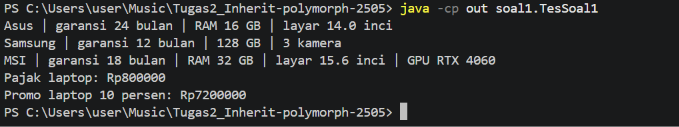
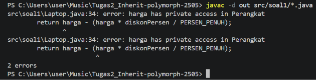
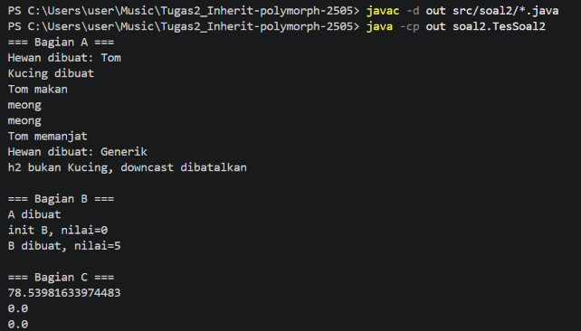
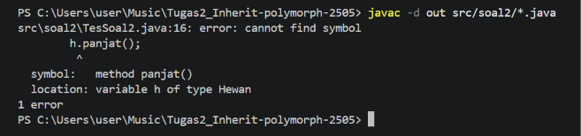
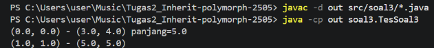
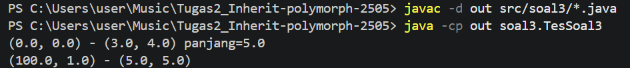
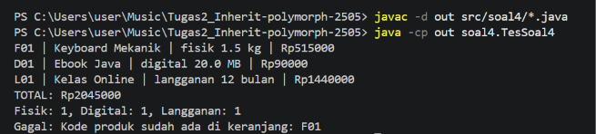

# Tugas 2 - Inheritance, Composition, dan Polimorfisme

- **Nama:** AS-SAJADAH KHAIRA
- **NPM:** 250810701100005
- **Kelas Praktikum:** Praktikum PBO A
- **Repository:** https://github.com/Saa69S/Tugas2_Inherit-polymorph-2505

## Deskripsi Singkat
Repository ini berisi pengerjaan Tugas 2 Praktikum PBO dengan bahasa Java (tanpa BlueJ). Ada empat soal: hierarki perangkat elektronik, analisis output dan polimorfisme, titik dan garis, serta mini project toko digital. Konsep yang dilatih adalah inheritance, composition, overriding dan overloading, polimorfisme, downcasting yang aman, dan exception. Setiap soal ditempatkan di package sendiri (`soal1` sampai `soal4`).

## Fitur Utama
**Soal 1: Hierarki Perangkat Elektronik**
- Menampilkan ringkasan laptop, ponsel, dan laptop gaming.
- Menghitung pajak 10 persen dan harga promo laptop setelah diskon.
- Memberi tambahan garansi 6 bulan untuk laptop gaming.
- Menolak merek kosong dan harga negatif.

**Soal 2: Analisis Output, Error, dan Polimorfisme**
- Menunjukkan urutan pembuatan objek, hasil override method, dan upcasting.
- Menunjukkan `ClassCastException` pada versi awal dan pencegahannya dengan `instanceof`.
- Menunjukkan akibat memanggil method yang di-override dari constructor.
- Menunjukkan masalah relasi is-a yang dipaksakan (Titik sebagai Lingkaran).

**Soal 3: Titik dan Garis**
- Membuat garis dari dua titik atau dari empat koordinat.
- Menghitung panjang garis dan mencetaknya dengan format `(x1, y1) - (x2, y2)`.
- Isi garis tidak berubah ketika titik di luar garis diubah (defensive copy).

**Soal 4: Toko Digital**
- Memasukkan produk fisik, digital, dan langganan ke satu keranjang.
- Mencetak struk berisi kode, nama, jenis, harga akhir, dan total belanja.
- Menghitung jumlah produk untuk tiap jenis.
- Menolak kode produk yang sudah ada, nama kosong, dan harga negatif.

## Konsep OOP yang Diterapkan
| Konsep | Lokasi | Alasan |
|---|---|---|
| Inheritance bertingkat | `Perangkat` > `Laptop` > `LaptopGaming` (soal1); `Produk` > `ProdukDigital` > `Langganan` (soal4) | Subclass adalah jenis khusus dari induknya, sehingga atribut dan perilaku dasar tidak perlu ditulis ulang |
| Atribut `protected` | `Perangkat.harga`, dipakai `Laptop.hitungHargaPromo()` | Subclass bisa membaca harga langsung, kelas di luar hierarki tidak |
| `super(...)` dan `super.infoSingkat()` | Constructor dan `infoSingkat()` pada semua subclass soal1 | Bagian induk dibuat lebih dulu dan kodenya tidak disalin |
| Encapsulation | Atribut `private` pada `Perangkat`, `Titik`, `Garis`, `Produk` | Data hanya diubah lewat method yang sudah divalidasi |
| Konstanta `final` | `TARIF_PAJAK`, `TAMBAHAN_GARANSI_BULAN`, `ONGKOS_KIRIM_PER_KG`, `DISKON_DIGITAL`, `DISKON_LANGGANAN`, `BATAS_BULAN_DISKON` | Menghindari magic number dan memudahkan perubahan tarif dari satu tempat |
| Method overriding | `infoSingkat()` (soal1), `suara()` dan `luas()` (soal2), `hitungHargaAkhir()` dan `deskripsi()` (soal4) | Tiap subclass punya perilaku sendiri untuk method yang sama |
| Method overloading | Dua constructor `Garis` (soal3) | Objek bisa dibuat dengan bentuk input berbeda |
| Constructor chaining `this(...)` | `Garis(x1, y1, x2, y2)` memanggil `Garis(Titik, Titik)` | Logika pembuatan objek tidak ditulis dua kali |
| Composition (has-a) | `Garis` punya dua `Titik` (soal3); `Keranjang` punya daftar `Produk` (soal4) | Garis bukan titik dan keranjang bukan produk |
| Polimorfisme | `cetakStruk()` dan `hitungTotal()` (soal4), `makan()` (soal2) | Satu perulangan atas tipe `Produk` memanggil method milik masing-masing objek |
| Downcasting aman | `TesSoal2` (soal2), `hitungPerJenis()` (soal4) | `instanceof` mencegah `ClassCastException`, dan `Langganan` dicek sebelum `ProdukDigital` |
| Defensive copy | `Garis.salin()` (soal3) | Isi `Garis` tidak berubah dari luar akibat aliasing |
| Exception | `IllegalArgumentException`, `IllegalStateException` | Data atau kondisi tidak valid ditolak sejak awal |

## Struktur Project
```
Tugas2_Inherit-polymorph-2505/
├── src/
│   ├── soal1/
│   │   ├── Perangkat.java
│   │   ├── Laptop.java
│   │   ├── Ponsel.java
│   │   ├── LaptopGaming.java
│   │   └── TesSoal1.java
│   ├── soal2/
│   │   ├── Hewan.java
│   │   ├── Kucing.java
│   │   ├── A.java
│   │   ├── B.java
│   │   ├── Lingkaran.java
│   │   ├── Titik.java
│   │   └── TesSoal2.java
│   ├── soal3/
│   │   ├── Titik.java
│   │   ├── Garis.java
│   │   └── TesSoal3.java
│   └── soal4/
│       ├── Produk.java
│       ├── ProdukFisik.java
│       ├── ProdukDigital.java
│       ├── Langganan.java
│       ├── Keranjang.java
│       └── TesSoal4.java
├── img/
├── .gitignore
└── README.md
```

## Prasyarat
- JDK 21 (diuji dengan versi 21.0.12.1)
- Visual Studio Code dengan Extension Pack for Java. IntelliJ IDEA juga bisa dipakai.

## Cara Menjalankan Program
**Lewat VS Code**
1. Buka folder repository dengan **File > Open Folder**.
2. Buka file `TesSoalX.java` yang ingin dijalankan (X = nomor soal).
3. Klik **Run** pada tulisan *Run | Debug* tepat di atas method `main`.
4. Hasilnya tampil di panel Terminal.

Jangan memakai tombol ▷ di pojok kanan atas editor. Tombol itu hanya mengompilasi satu file dan gagal karena program memakai package.

**Lewat IntelliJ IDEA (run configuration)**
1. Buka folder repository sebagai project, lalu klik kanan folder `src` > **Mark Directory as** > **Sources Root**.
2. Buka **Run > Edit Configurations**, klik **+**, lalu pilih **Application**.
3. Isi **Main class** dengan `soal1.TesSoal1` (ganti sesuai soal), pilih JDK 21, lalu klik **Apply** dan **Run**.

**Lewat command line** (dijalankan dari folder utama repository)
```
javac -d out src/soal1/*.java src/soal2/*.java src/soal3/*.java src/soal4/*.java
java -cp out soal1.TesSoal1
java -cp out soal2.TesSoal2
java -cp out soal3.TesSoal3
java -cp out soal4.TesSoal4
```

## Jawaban Tiap Soal
### Soal 1: 
- Output yang diharapkan
```
Asus | garansi 24 bulan | RAM 16 GB | layar 14.0 inci
Samsung | garansi 12 bulan | 128 GB | 3 kamera
MSI | garansi 18 bulan | RAM 32 GB | layar 15.6 inci | GPU RTX 4060
Pajak laptop: Rp800000
Promo laptop 10 persen: Rp7200000
```
#### Output Program


- **Pertanyaan Tambahan**
**Pertanyaan:** ubah `harga` menjadi `private` lalu kompilasi. Salin pesan error dan jelaskan.
- Pesan error yang muncul:
```
src\soal1\Laptop.java:39: error: harga has private access in Perangkat
        return harga - (harga * diskonPersen / PERSEN_PENUH);
               ^
src\soal1\Laptop.java:39: error: harga has private access in Perangkat
        return harga - (harga * diskonPersen / PERSEN_PENUH);
2 errors
```

- Penjelasan: atribut `private` hanya bisa diakses dari dalam kelas yang mendeklarasikannya, yaitu `Perangkat`. Subclass `Laptop` memang mewarisi atribut itu, tetapi tidak boleh mengaksesnya langsung. Error muncul dua kali karena `harga` dipakai dua kali dalam satu ekspresi. Dengan `protected`, subclass boleh mengakses langsung, sedangkan kelas di luar hierarki (selain satu package) tetap tidak. Cara lain adalah membuat method getter `public`.


### Soal 2
#### Output Diharapkan
```
=== Bagian A ===
Hewan dibuat: Tom
Kucing dibuat
Tom makan
meong
meong
Tom memanjat
Hewan dibuat: Generik
h2 bukan Kucing, downcast dibatalkan

=== Bagian B ===
A dibuat
init B, nilai=0
B dibuat, nilai=5

=== Bagian C ===
78.53981633974483
0.0
0.0
```
#### Output Program


**Bagian A**

**1. Output lengkap sampai program berhenti.**
- Prediksi: seluruh output berurutan seperti di bawah, lalu berhenti dengan `ClassCastException`.
- Hasil sebenarnya (versi awal sebelum perbaikan):
  ```
  Hewan dibuat: Tom
  Kucing dibuat
  Tom makan
  meong
  meong
  Tom memanjat
  Hewan dibuat: Generik
  Exception in thread "main" java.lang.ClassCastException: class soal2.Hewan cannot be cast to class soal2.Kucing ...
  ```
- Penjelasan: pada `new Kucing("Tom")`, constructor `Kucing` memanggil `super(nama)` lebih dulu, sehingga "Hewan dibuat" tercetak sebelum "Kucing dibuat". Di dalam `makan()`, `suara()` yang jalan adalah versi `Kucing`, jadi tercetak "meong". Cast `(Kucing) h` berhasil karena objek aslinya memang Kucing. Pada `Hewan("Generik")`, cast ke `Kucing` gagal sehingga program berhenti dan `k2.panjat()` tidak pernah dijalankan.

### 2. Jika komentar pada `h.panjat();` dihapus

* **Prediksi:** Error saat kompilasi.
* **Hasil Sebenarnya:**




- Penjelasan: error terjadi pada tahap **kompilasi**, bukan runtime. Compiler hanya melihat tipe statis variabel `h`, yaitu `Hewan`, dan kelas `Hewan` tidak punya method `panjat()`. Compiler tidak memeriksa objek aslinya.

**3. Baris penyebab `ClassCastException` dan perbaikannya.**
- Baris penyebab: `Kucing k2 = (Kucing) h2;`
- Penjelasan: `h2` dibuat dengan `new Hewan("Generik")`, jadi objek aslinya hanya `Hewan`. Memaksa `Hewan` menjadi `Kucing` gagal saat program berjalan.
- Perbaikan dengan `instanceof`, tanpa mengubah tipe variabel `h2`:
  ```java
  Hewan h2 = new Hewan("Generik");
  if (h2 instanceof Kucing) {
      Kucing k2 = (Kucing) h2;
      k2.panjat();
  } else {
      System.out.println("h2 bukan Kucing, downcast dibatalkan");
  }
  ```

**4. `suara()` pada `h.makan()` milik kelas mana.**
- Jawaban: milik kelas **`Kucing`**.
- Penjelasan: tipe statis `h` adalah `Hewan` (tipe yang tertulis di kiri), sedangkan tipe dinamisnya `Kucing` (objek yang dibuat dengan `new`). Tipe statis dipakai compiler untuk memeriksa method apa yang boleh dipanggil. Tipe dinamis dipakai saat program berjalan untuk memilih versi method yang dieksekusi (dynamic dispatch). Karena `Kucing` meng-override `suara()`, versi `Kucing` yang berjalan walaupun `makan()` ditulis di `Hewan`.

**Bagian B**
**5. Output `new B();`.**
- Prediksi dan hasil sebenarnya:
  ```
  A dibuat
  init B, nilai=0
  B dibuat, nilai=5
  ```
- Mengapa `nilai` bukan 5 pada baris "init B": constructor `B` memanggil `super()` lebih dulu, sehingga constructor `A` berjalan sebelum atribut `nilai = 5` milik `B` diisi. Di dalam constructor `A`, `init()` dipanggil dan yang jalan adalah `init()` milik `B` karena di-override. Saat itu `nilai` masih berisi nilai bawaan `int`, yaitu 0. Atribut baru diisi 5 setelah constructor `A` selesai.
- Risiko memanggil method yang bisa di-override dari constructor: method milik subclass bisa berjalan ketika objek subclass belum selesai dibuat, sehingga atributnya masih berisi nilai bawaan (0, `null`, atau `false`). Hasilnya bisa salah atau menimbulkan `NullPointerException`, dan bug-nya sulit dilacak. Cara menghindarinya: jangan panggil method yang bisa di-override dari constructor, atau jadikan method itu `private` atau `final`.

**Bagian C**
**6. Mengapa `l3.luas()` menghasilkan 0.0.**
- Hasil: `78.53981633974483`, `0.0`, `0.0`.
- Alasan: tipe statis `l3` adalah `Lingkaran`, tetapi objeknya dibuat dengan `new Titik()`, sehingga tipe dinamisnya `Titik`. Saat program berjalan, Java memilih `luas()` milik `Titik` (dynamic dispatch), dan versi itu selalu mengembalikan 0.0.
- Apakah "Titik adalah sebuah Lingkaran" masuk akal sebagai relasi is-a: kurang masuk akal. Titik memang bisa dianggap lingkaran berjari-jari nol, tetapi relasi is-a dalam pemrograman berarti subclass bisa menggantikan superclass tanpa merusak harapan pemakainya. Lingkaran diharapkan punya luas positif, sedangkan `Titik` tidak.
- Konsekuensi jika suatu method mengharapkan `Lingkaran` yang selalu punya luas lebih dari nol: method itu bisa menghasilkan hasil yang salah atau gagal ketika diberi `Titik`, misalnya terjadi pembagian dengan nol bila luas dipakai sebagai pembagi. Masalahnya tersembunyi karena compiler tidak mengeluh, sebab `Titik` memang subclass `Lingkaran`.


### Soal 3
#### Output yang diharapkan
```
(0.0, 0.0) - (3.0, 4.0) panjang=5.0
(1.0, 1.0) - (5.0, 5.0)
```
#### Output Program


**1. Apa yang tercetak pada baris kedua dan mengapa.**
- Prediksi dan hasil sebelum perbaikan: `(100.0, 1.0) - (5.0, 5.0)`

- Penjelasan: constructor `Garis` menyimpan **referensi** ke objek `Titik` yang sama dengan `t`, bukan salinannya. Ketika `t.setX(100)` dipanggil, objek yang sama itu berubah, dan `g2` ikut berubah. Kejadian dua variabel menunjuk ke satu objek ini disebut aliasing.

**2. Setelah defensive copy.**
- Constructor `Garis` diubah agar menyimpan salinan titik (`new Titik(x, y)`), dengan helper `salin()`. Getter dan setter juga memakai salinan.
- Hasil: `(1.0, 1.0) - (5.0, 5.0)`
- Perubahan `t.setX(100)` sekarang hanya mengubah `t`, bukan titik di dalam `Garis`.

**3. Kapan perilaku sebelum dan sesudah perbaikan lebih tepat.**
- Sebelum perbaikan (berbagi objek) lebih tepat ketika garis memang harus selalu mengikuti posisi titik aslinya, misalnya garis penghubung dua objek yang bergerak, atau satu titik yang sengaja dipakai bersama beberapa bentuk sehingga memindahkan titik otomatis memindahkan semuanya.
- Sesudah perbaikan (salinan) lebih tepat ketika `Garis` harus menjaga datanya sendiri dan tidak boleh berubah tanpa disengaja karena kode lain. Ini lebih aman, lebih mudah dilacak, dan cocok untuk kerja tim.

**4. Masalah desain jika `Garis` dibuat dengan `extends Titik`.**
- Relasi is-a tidak masuk akal: garis bukan sebuah titik. Garis juga tidak bisa dipakai di tempat yang mengharapkan `Titik`.
- `Garis` akan mewarisi satu pasang koordinat `x, y`, padahal ia membutuhkan dua titik, sehingga warisan itu tidak berarti dan membingungkan.
- Method turunan seperti `getX()`, `getY()`, dan `jarakKe()` menjadi ambigu: koordinat garis yang mana?
- Relasi has-a lebih tepat: sebuah garis **memiliki** dua titik, yang direpresentasikan dengan composition.


### Soal 4
#### Output yang diharapkan
```
F01 | Keyboard Mekanik | fisik 1.5 kg | Rp515000
D01 | Ebook Java | digital 20.0 MB | Rp90000
L01 | Kelas Online | langganan 12 bulan | Rp1440000
TOTAL: Rp2045000
Fisik: 1, Digital: 1, Langganan: 1
Gagal: Kode produk sudah ada di keranjang: F01
```
#### Output Program



### Analisis Konsep
**1. Perbedaan method overriding dan overloading**
Overriding adalah subclass menulis ulang method induknya dengan nama dan parameter yang sama agar perilakunya berbeda; contohnya `infoSingkat()` di `LaptopGaming` menggantikan versi `Laptop` untuk menambahkan GPU. Overloading adalah beberapa method atau constructor bernama sama dengan parameter berbeda dalam satu kelas; contohnya `Garis(Titik, Titik)` dan `Garis(double, double, double, double)`. Overriding berkaitan dengan inheritance dan polimorfisme karena versi method dipilih saat program berjalan dari objek aslinya, sedangkan overloading dipilih compiler dari parameternya.

**2. Kapan memilih inheritance dan kapan composition**
Inheritance dipilih ketika hubungannya "adalah sebuah" (is-a), misalnya `LaptopGaming` adalah sebuah `Laptop`, sehingga atribut dan method `Laptop` diwarisi dan hanya GPU yang ditambahkan. Composition dipilih ketika hubungannya "memiliki" (has-a), misalnya `Garis` memiliki dua `Titik` dan `Keranjang` memiliki daftar `Produk`. Memaksakan inheritance pada hubungan has-a membuat desain janggal dan data yang diwarisi tidak bermakna.

**3. Mengapa `cetakStruk()` tidak perlu `instanceof` tetapi `hitungPerJenis()` perlu, dan mengapa downcasting tidak selalu aman**
`cetakStruk()` hanya memanggil `hitungHargaAkhir()` dan `deskripsi()` yang ada di `Produk`, dan Java otomatis menjalankan versi milik objek aslinya (polimorfisme). `hitungPerJenis()` harus tahu jenis konkret tiap produk untuk menghitung per kategori, dan informasi itu tidak tersedia lewat method bersama, jadi harus diperiksa dengan `instanceof`, dengan `Langganan` dicek lebih dulu karena ia juga `ProdukDigital`. Downcasting tidak selalu aman karena objek aslinya belum tentu bertipe yang dituju; jika dipaksa tanpa `instanceof`, program berhenti dengan `ClassCastException` saat berjalan, seperti `(Kucing) h2` pada Soal 2.

## Batasan dan Pengembangan Lanjutan
- Tantangan opsional `ProdukBundel` belum dikerjakan.
- Data keranjang hanya disimpan di memori (`ArrayList`), sehingga hilang ketika program berhenti.
- Validasi baru mencakup nama kosong dan harga negatif. Berat, ukuran, durasi negatif, dan kode produk kosong belum diperiksa.
- Belum ada unit test otomatis; pengujian masih lewat kelas `TesSoalX` dan pembandingan output secara manual.
- `Keranjang` belum punya fitur menghapus atau mencari produk.